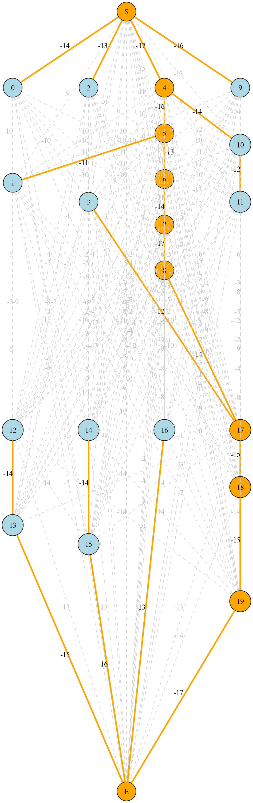

# DAT026 Conference problem with MST

MST solution with example conference from the lecture:

## Generating the graph

1. Install dependencies with pip from `requirements.txt` or use the Nix flake.
2. Run `python main.py`
